## Часть 1 — Ограждения на кластер

Выбрал Gatekeeper в основном потому что у нас в комании уже используется kyverno и интересно потрогать альтернативу. В целом gatekeeper дает большую гибкость в валидационных и мутационных правилах за счет использования в них полноценного языка, однако в свою очередь не имеет возможности генерировать и удалять ресурсы, kyverno же не супер стабильно работает на крупных инсталляциях, хотя последние версии улучшают данный момент.

Описания политик:

1. mem-limit -- требует одинаковых значений в requests и limits для памяти, такое предотвращает overcommit на ноде и возможные OOM
2. latest-tag -- запрещает тэг latest для образов, базовая защита от непреднамеренных обновлений
3. namespace -- требует лейбла app на неймспейсе, помогает при разметке и аттрибуции ресурсов в кластере
4. priviledged -- запрещает priviledged контейнеры, уменьшает возможости получить привелигированные права на ноде
5. requests -- требует установки requests, предотвращает overcommit ресурсов

Для проверки подготовили 5 «плохих» манифестов применили их и Gatekeeper отклонил все пять, в каждом отказе указано сработавшее правило:

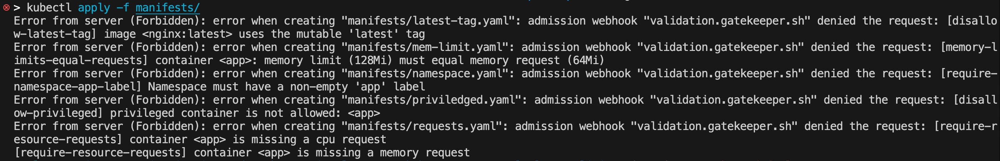

## Часть 2 — Чарт для api и worker

Написали шаблоны Deployment/Service для api и worker. У обоих есть readiness- и liveness-пробы, у всех контейнеров указаны requests, у памяти limit равен request, контейнеры не привилегированные. Поэтому чарт установился без отказов от Gatekeeper.

**Восстановление пода.** Удалили руками один под api. Deployment сразу создал вместо него новый, реплик снова 3:

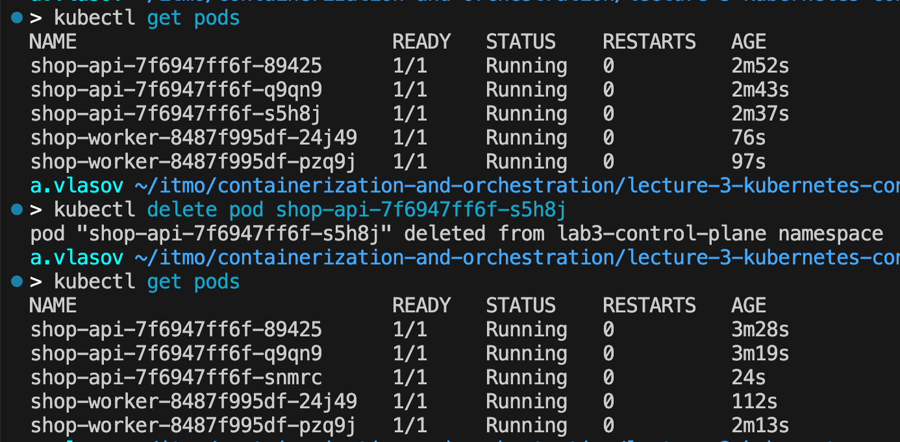

**Изменение replicas.** Уменьшили количетсво подов в релизе и оно подтянулось к новому значению, их стало 2:

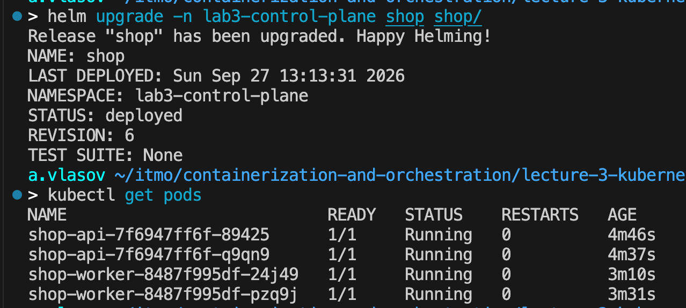

**Rolling update.** Подняли версию образа и выполнили upgrade, параллельно в цикле дёргая /health. Поды менялись по одному, и ни один запрос не упал: `total=93 failed=0`. Чтобы запросы не попадали в под, который уже останавливается, у api есть preStop-хук: под сначала помечает себя NotReady и ждёт DRAIN_DELAY, пока его уберут из endpoints, и только потом получает SIGTERM.

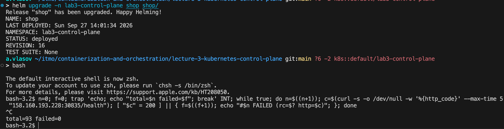

**Сломанная версия и откат.** Выставили `HEALTH_FAIL=true` и снова сделали upgrade. Новый под так и не прошёл readiness, поэтому старые здоровые поды не удалялись, и сервис продолжал отвечать. Выполнили `helm rollback shop 16`: сломанный под исчез, кластер вернулся к двум рабочим подам.

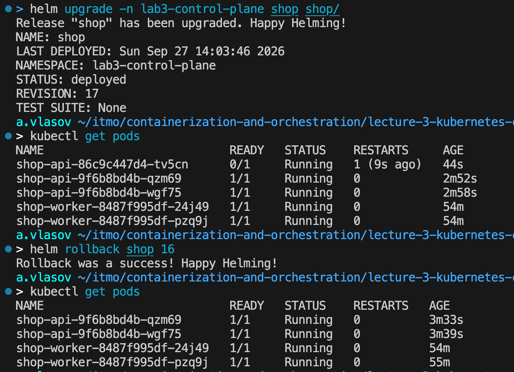

## Часть 3 — Postgres через оператора

Оператор — **CloudNativePG**, поставлен один раз на весь кластер (namespace `cnpg-system`). В чарт `shop` добавлены `templates/postgres-credentials.yaml` (Secret с логином/паролем) и `templates/postgres-cluster.yaml` (объект `Cluster`: 1 инстанс, диск 300Mi, `bootstrap.initdb` создаёт базу `shop`).

**Самоисцеление:** `kubectl delete pod shop-postgres-1 -n lab3-control-plane` → под вернулся сам, с тем же именем и тем же диском (в отличие от `api`, где под взаимозаменяем, у базы конкретные данные на конкретном PVC).

**spec/status** (`kubectl get cluster shop-postgres -n lab3-control-plane -o yaml`): `spec` — то, что написано руками в `postgres-cluster.yaml`. `status` целиком заполняет оператор: `readyInstances`, `currentPrimary: shop-postgres-1`, версия образа, health-проверки — результат его reconciliation loop.

**Отличие оператора и `controller-manager`:** оба непрерывно сверяют actual и desired state через API server — механизм тот же. В основном отличие в нюансах настроек и конкретизации под сущность: `controller-manager` универсален (для него `Deployment` — это просто N одинаковых подов), а CloudNativePG понимает предметную область Postgres — знает про primary/replica, сам поставил `Termination Grace Period: 1800s` вместо стандартных 30 секунд, чтобы база не оборвалась на середине checkpoint, из-за этого под был довольно долго в состоянии Terminating.
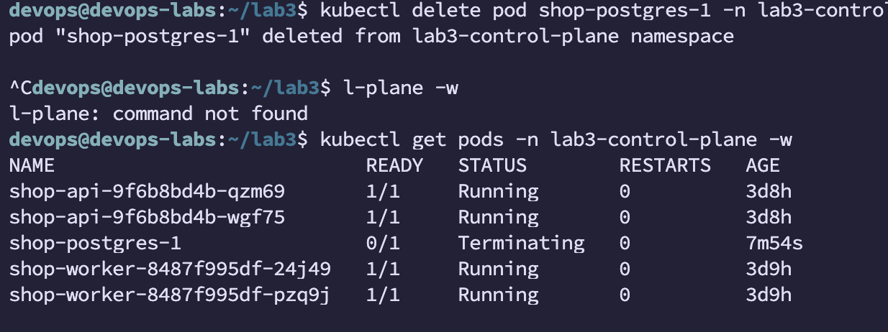

## Часть 4 — Падение control plane

Для проверки поведения приложения при недоступности control plane был временно заблокирован порт Kubernetes API Server 6443 с помощью iptables.

Перед отключением control plane было проверено, что контейнеры приложения и PostgreSQL запущены. Для этого использовалась команда crictl ps с фильтрацией контейнеров shop и postgres. После этого порт 6443 был заблокирован правилом iptables.

На рисунке part_4_1.png видно, что после блокировки Kubernetes API перестал быть доступен: команда kubectl get pods завершилась ошибкой соединения, а попытка выполнить helm upgrade также не прошла, поскольку Helm не смог связаться с Kubernetes API.

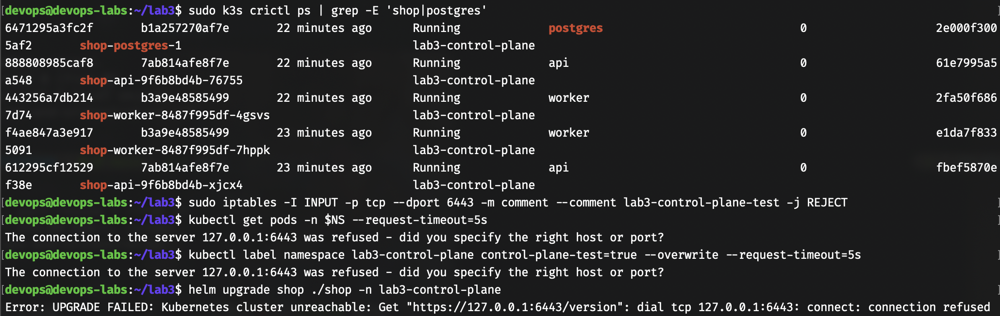

При этом уже запущенные workload'ы продолжили работать. Для проверки были выполнены HTTP-запросы к API приложения. Эндпоинт `/healt `продолжил возвращать успешный ответ, а `/orders` успешно вернул данные из PostgreSQL. Таким образом, несмотря на недоступность control plane, само приложение и его соединение с базой данных продолжили работать.

Это показано на рисунке part_4_2.png.

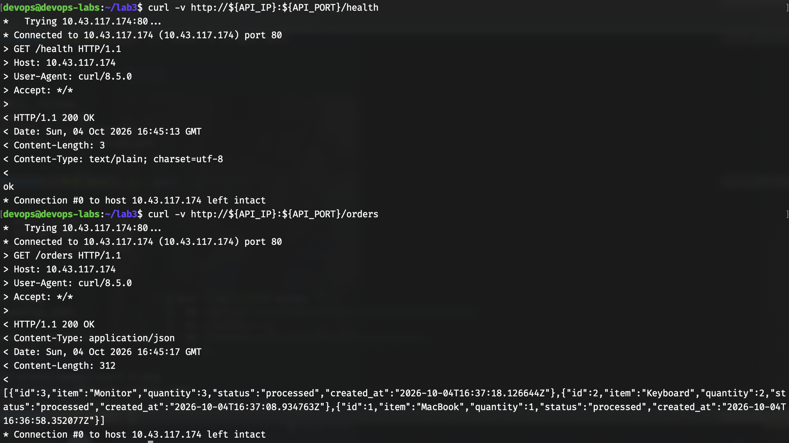

Дополнительно состояние контейнеров было проверено напрямую через container runtime при помощи crictl. На рисунке part_4_3.png видно, что контейнеры shop продолжали выполняться даже при недоступном Kubernetes API.

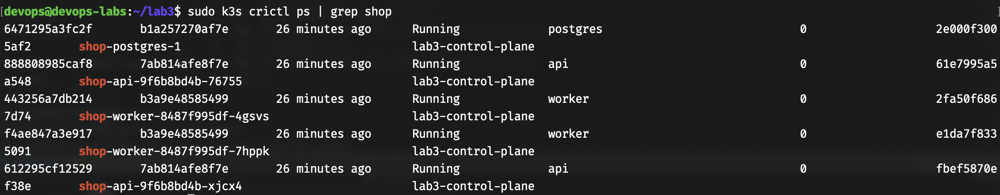

После завершения проверок недоступности правило iptables, которе блокировало порт 6443, было удалено. После восстановления доступа к control plane были выполнены команды проверки состояния ноды, pod'ов, объекта PostgreSQL Cluster и Helm-релизов.

На рисунке part_4_4.png видно, что после восстановления соединения команды kubectl и helm снова начали выполняться штатно, а кластер вернулся в управляемое состояние.

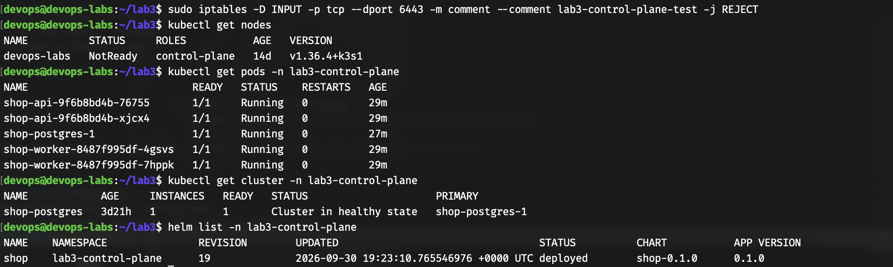

Таким образом, эксперимент показал разделение control plane и уже запущенных workload'ов: при потере доступа к Kubernetes API нельзя создавать или изменять ресурсы кластера, однако существующие контейнеры продолжают выполняться и обслуживать пользовательские запросы. После восстановления API Server управление кластером также восстановилось.

## Часть 5 — Мониторинг

Для мониторинга приложения был переиспользован стек из лабораторной работы №2. Для поддержки ресурсов ServiceMonitor и PrometheusRule дополнительно был установлен Prometheus Operator. При этом уже существующие компоненты мониторинга, например Grafana, были сохранены и использованы повторно.

### ServiceMonitor

В Helm-чарт shop был добавлен шаблон ServiceMonitor, предназначенный для автоматического обнаружения и сбора метрик с shop-api.

На рисунке part_5_1.png показан созданный servicemonitor.yaml. В селекторе используются метки instance и component, позволяющие выбрать именно Service компонента API. В качестве endpoint указан /metrics.

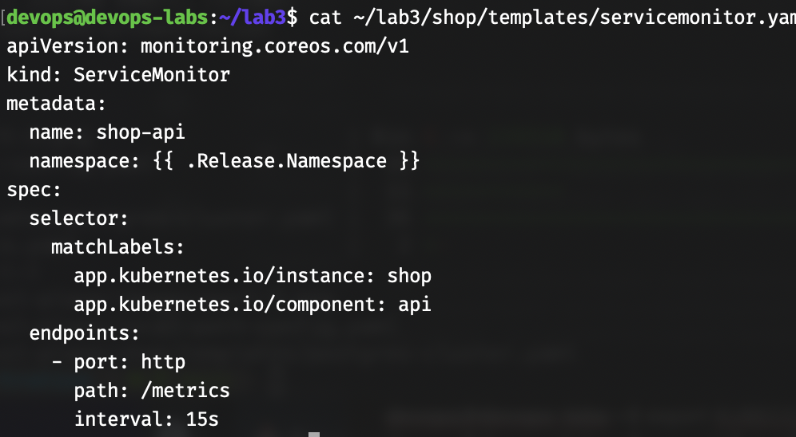

ServiceMonitor находит Service shop-api, после чего Prometheus получает адреса его endpoint'ов и периодически обращается к /metrics. В результате обе реплики API появились в Targets Prometheus в состоянии UP, а метрики приложения стали доступны в Grafana.

### PrometheusRule

Для алертинга в Helm-чарт также был добавлен шаблон PrometheusRule. В нём были определены три правила:

- ShopApiDown — срабатывает, если Prometheus перестаёт успешно собирать метрики с одной из реплик API;
- ShopApi5xxErrors — срабатывает при появлении HTTP-ответов с кодами 5xx;
- ShopApiHighLatency — контролирует рост p95 времени ответа API.

Созданные правила показаны на рисунке part_5_2.png.

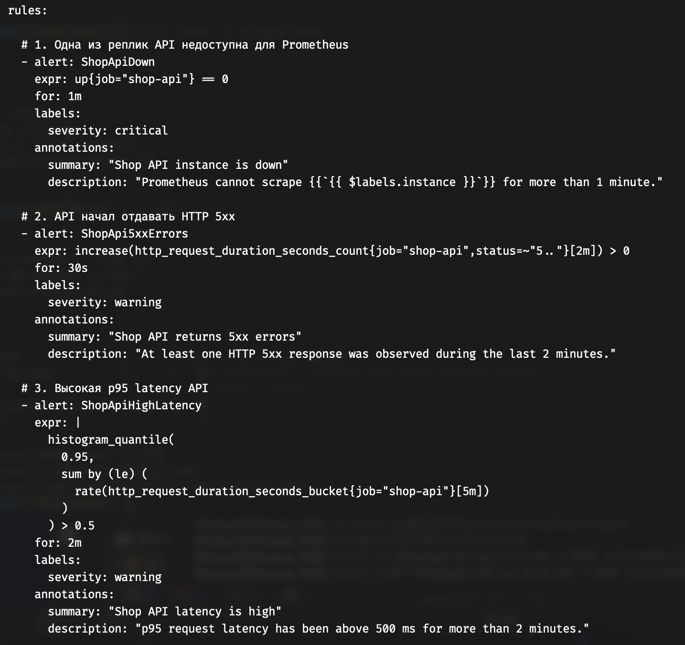

Так как PrometheusRule является частью Helm-чарта shop, правила устанавливаются и обновляются вместе с остальными компонентами приложения через helm upgrade.

Проверка срабатывания алерта

Для проверки алертинга была искусственно создана проблема при работе API с PostgreSQL. Параметры подключения к БД были временно изменены таким образом, чтобы запросы к базе завершались ошибкой.

После выполнения rollout приложение осталось запущенным, однако обращения к endpoint, использующему PostgreSQL, начали возвращать HTTP 500 и сообщение db error. Результат эксперимента приведён на рисунке part_5_3.png.

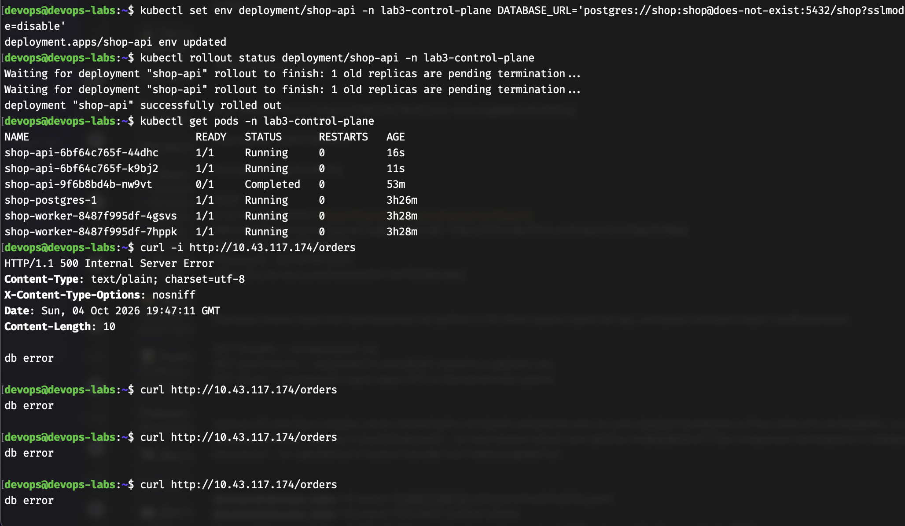

Эти ошибки также стали видны на графике HTTP-статусов в Grafana. На рисунке part_5_4.png видно, как количество успешных ответов 200 уменьшается, одновременно появляется рост ответов 500. После восстановления корректного подключения к PostgreSQL ситуация меняется обратно: количество 500 падает, а успешные ответы снова начинают преобладать.

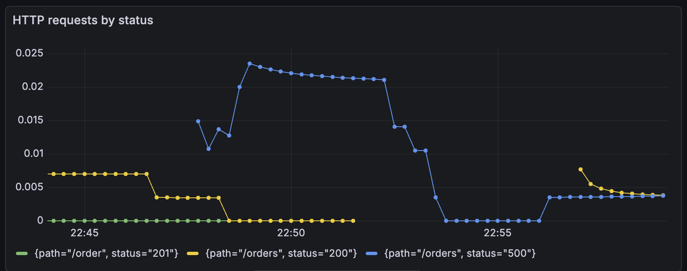

Таким образом, метрики позволяют увидеть не только факт недоступности приложения, но и его частичную деградацию, когда сам API продолжает работать, однако часть операций завершается серверной ошибкой.

В ходе тестирования Prometheus зарегистрировал срабатывания настроенных правил. На рисунке part_5_5.png видны события алертинга, в том числе срабатывания около 22:48 и 22:57.

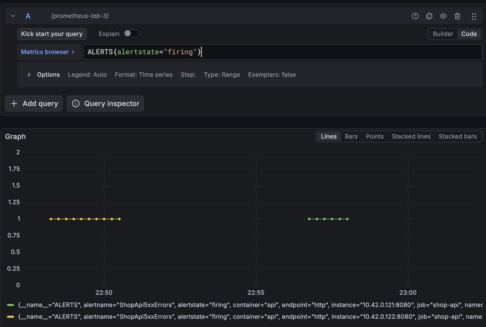

На рисунке part_5_6.png показано итоговое состояние правил в Grafana. Одно из правил находится в состоянии Firing, то есть условие алерта в данный момент выполняется. Два остальных правила находятся в состоянии Normal.

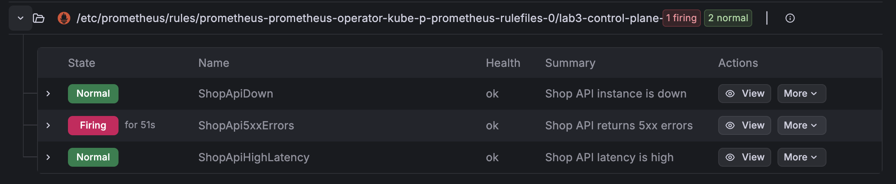

В результате для приложения был настроен полный минимальный цикл мониторинга: ServiceMonitor автоматически подключает метрики API к Prometheus, PrometheusRule задаёт три правила контроля состояния сервиса, а Grafana используется для визуализации метрик и состояния алертов. При искусственно созданном сбое удалось увидеть изменение HTTP-метрик и довести одно из правил до состояния Firing, что подтверждает работоспособность настроенного мониторинга.
