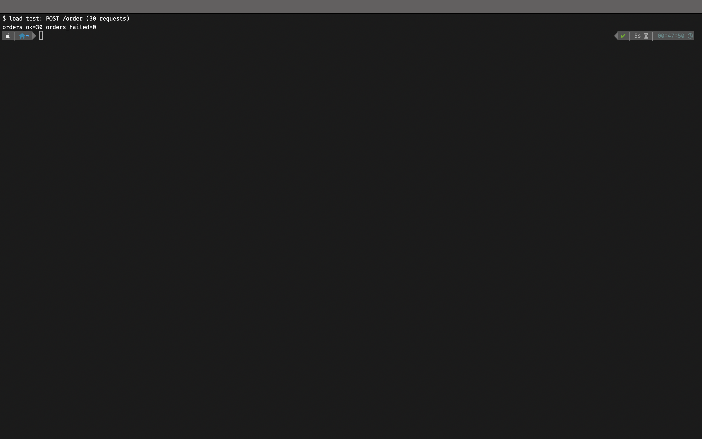

## Часть 1 

podAntiAffinity и topologySpreadConstraints определяют правила по которым scheduler выбирает ноду для заселения пода, первый позволяет задать параметры пода который не должен находится рядом с планируемым, второй дает возможность указать распределение некоторого набора подов (по лейблам), а также возможную разницу в этом распределении. Например поды api и worker можно настроить таким образом чтобы они не оказывались на одной ноде с помощью podAntiAffinity, а через topologySpreadConstraints задать, чтобы разница в количестве подов api на нодах не превышала одного. 

В этом случае, поскольку количество реплик мало, то для равномерного распределения по нодам можно использовать podAntiAffinity.

## Часть 2

Дописали batch в чарт и подняли в кластере.

## Часть 3 — Рекомендации krr

Сначала проверил order path нагрузкой:

```bash
POST /order — 300 запросов
```

Все запросы завершились успешно. Короткая повторная проверка показана на рисунке 

.

После этого включил в Prometheus сбор cAdvisor и kube-state-metrics и запустил `krr` для namespace `lab3-control-plane`. Отчёт сохранён в [krr-report.yaml](krr-report.yaml), снимок вывода: [part_3_krr.png](part_3_krr.png).

Рекомендации `krr`:

- `api`: CPU request `10m`, memory request/limit `100Mi`;
- `worker`: CPU request `10m`, memory request/limit `100Mi`;
- `batch`: CPU request `1004m`, memory request/limit `100Mi`.

Для CPU `krr` рекомендует не задавать limit. Для `postgres` отдельной рекомендации нет, потому что он создаётся оператором CloudNativePG и не определяется `krr` как обычный Deployment или StatefulSet.

Исходные значения в chart были `50m/64Mi` для `api` и `worker`. Рекомендации `krr` показали, что для этих сервисов memory request нужно увеличить до `100Mi`, а CPU request снизить до `10m`.

Значения перенесены в `lecture-3-kubernetes-control-plane/shop/values.yaml`. Первая попытка `helm upgrade` завершилась по timeout: на сервере была одна нода, а обязательный `podAntiAffinity` не позволил временно разместить новую ReplicaSet. Это показано на рисунке [part_3_upgrade_blocked.png](part_3_upgrade_blocked.png).

После добавления второй worker-ноды upgrade завершился успешно. Для rollout также задано `maxUnavailable: 1`, потому что при обязательном anti-affinity старую ReplicaSet нужно сначала уменьшить, чтобы новая реплика смогла занять освободившуюся ноду.

## Часть 4 — Распределение API по нодам

Для `api` используется `podAntiAffinity` с `topologyKey: kubernetes.io/hostname`. Это запрещает размещать две реплики API на одной ноде.

Проверил командой:

```bash
kubectl get pods -n lab3-control-plane -l app.kubernetes.io/component=api -o wide
```

Результат проверки показан на рисунке [part_4_spread.png](part_4_spread.png). В кластере видны ноды `devops-labs` и `worker-2b`, а реплики `api` работают на разных нодах.

Вторая worker-нода запущена как отдельный k3s-agent контейнер на той же ВМ. Для Kubernetes это отдельная нода с отдельным hostname, но физически обе ноды зависят от одной ВМ.

Правило anti-affinity применилось: scheduler не разместил две реплики `api` на одной ноде. При отказе одной Kubernetes-ноды вторая реплика остаётся на другой ноде.

## Часть 5 — Приоритеты, QoS и PDB

В `values.yaml` добавлены два класса приоритета:

- `shop-critical` со значением `100000` для `api` и `postgres`;
- `shop-batch` со значением `100` для фоновой нагрузки `batch`.

Большое значение priority позволяет критичным pod’ам получить преимущество при дефиците ресурсов и вытеснить менее важные pod’ы. `batch` имеет меньший приоритет.

Для `api` и `postgres` requests равны limits:

- `api`: CPU `10m`, memory `100Mi`;
- `postgres`: CPU `100m`, memory `256Mi`.

Поэтому эти pod’ы относятся к QoS `Guaranteed`. Для `batch` requests меньше limits: CPU `100m`/`2`, memory `100Mi`/`256Mi`. Его QoS: `Burstable`.

Добавлены PDB `shop-api` и `shop-postgres-pdb` с `minAvailable: 1`. Для PostgreSQL также остаётся PDB `shop-postgres-primary`, который создаётся оператором CloudNativePG.

После `helm upgrade` `api` имеет priority `100000` и QoS `Guaranteed`, `batch` имеет priority `100` и QoS `Burstable`, а новый PostgreSQL pod получил priority `100000` и QoS `Guaranteed`. После штатного restart CloudNativePG кластер вернулся в состояние `Cluster in healthy state`.

Результат проверки показан на рисунке [part_5_priority_pdb.png](part_5_priority_pdb.png).

PDB ограничивает добровольные disruption’ы и не запрещает принудительное вытеснение при preemption или отказ ноды. При memory pressure kubelet сначала рассматривает менее защищённые QoS-классы, поэтому `batch` должен пострадать раньше критического пути.

## Часть 6 — Дефицит, Pending и preemption

Чтобы получить нехватку ресурсов малым числом pod’ов, увеличил и `batch.replicaCount`, и request на одну реплику. Значения в `values.yaml`:

- `replicaCount: 3`;
- requests: CPU `500m`, memory `4000Mi`;
- limits: CPU `600m`, memory `4200Mi`.

Реально `batch` использует около 64 MiB (`memMb: 64`), но scheduler учитывает зарезервированные requests, а не потребление. Поэтому на двух нодах поместились только две реплики, а третья осталась `Pending` с событием `0/2 nodes are available: 2 Insufficient memory`. Это показано на рисунках [part-6-1.png](images/part-6-1.png) (событие `FailedScheduling`) и [part-6-2.png](images/part-6-2.png) (pod `shop-batch-...-wvr7l` в статусе `Pending`).

Для проверки preemption создал тестовый pod `preempt-test` с `priorityClassName: shop-critical` и request memory `3600Mi`, больше, чем свободно на любой ноде. Использовал тестовый pod с приоритетом критичного пути вместо `api`/`postgres`: механизм тот же, решает значение priority.

Первый запуск вытеснил оба pod’а `shop-worker`, а не `batch` ([part6-3.png](images/part6-3.png)). Причина: у `worker` не было `priorityClassName` (в шаблоне `worker-deployment.yaml` поле отсутствовало), и он имел приоритет `0`, ниже `batch` (`100`). После добавления поля в шаблон и `values.yaml` (`shop-critical`) повторил тест. Второй тестовый pod `preempt-test-2` вытеснил именно `batch`: событие `Preempted pod/shop-batch-... by pod ... on node worker-2b`, затем `preempt-test-2` назначен на `worker-2b` ([part6-4.png](images/part6-4.png)). Вытесненная реплика `batch` пересоздалась и снова стала `Pending`.

Вывод: `Pending` возникает, когда не хватает зарезервированных requests, а preemption освобождает место для pod’а с большим приоритетом за счёт pod’а с меньшим. PDB при этом не мешает, он ограничивает только добровольные disruption’ы.

## Часть 7 — Memory pressure и порядок eviction

Обе «ноды» работают на одной ВМ, поэтому довести память до реального исчерпания опасно: ВМ перестаёт отвечать. Вместо этого сдвинул порог eviction, по аналогии с увеличением requests в части 6. Для kubelet на `worker-2b` порог `memory.available` поднят со `100Mi` до `3Gi` флагом `--kubelet-arg=eviction-hard=memory.available<3Gi,...`. Базовая доступная память ноды (по `stats/summary`) была около 3.4–4.2 GiB, выше порога.

Настройки `batch` для части 7:

- `memMb: 500`, `replicaCount: 2`;
- requests: CPU `100m`, memory `100Mi`;
- limits: CPU `600m`, memory `3000Mi`.

`batch` остаётся Burstable, реально использует ~512 MiB, то есть больше своих requests (`100Mi`), но намного меньше limit. Когда `available` на `worker-2b` упала ниже `3Gi`, kubelet выставил `MemoryPressure=True` и выселил pod `batch`. Событие на рисунке [part7-evection.png](images/part7-evection.png):

`Evicted: The node was low on resource: memory. Threshold quantity: 3Gi, available: 3116200Ki. Container batch was using 523880Ki, request is 100Mi, has larger consumption of memory.`

Критичный путь не пострадал: `api` и `postgres` остались `Running`. До `batch` kubelet также выселил несколько BestEffort pod’ов из `lab2-observability` (у них request равен 0). Это соответствует порядку eviction: сначала pod’ы без requests и использующие память сверх requests, затем по приоритету. `batch` попал в выселяемые раньше `api` и `postgres`, потому что у него ниже приоритет и он превысил requests, тогда как у `Guaranteed` pod’ов использование не выходит за requests.

Отличие от `OOMKilled`: eviction это решение kubelet на уровне ноды, когда на ней не хватает памяти; он выбирает pod по QoS, превышению requests и приоритету, а в событии есть причина `The node was low on resource: memory`. `OOMKilled` это решение ядра на уровне контейнера, когда он превысил собственный memory limit; в статусе контейнера `Reason: OOMKilled`, `Exit Code: 137`. Внешне оба случая выглядят как исчезновение или перезапуск pod’а, но диагноз разный: в первом случае не хватает памяти на ноде и нужно смотреть requests и приоритеты, во втором слишком мал limit самого контейнера.

## Часть 8 — SLA критичного пути под нагрузкой

**SLA:** 95% запросов `POST /order` быстрее 300 мс и доля ошибок меньше 1%, в том числе пока `batch` перегружает ноды.

Нагрузка: pod `williamyeh/hey` внутри кластера, 10 соединений по 10 запросов в секунду, около 100 RPS, `POST /order` на сервис `shop-api`.

**Подготовка.** Первый прогон без `batch` SLA не прошёл: p95 составил 1.61 с при 20.8 RPS. Причина в CPU throttling: у `api` limit `10m`, у `postgres` `100m` (значения requests = limits из части 5), и по метрикам cAdvisor они упирались в квоту в 86–98% периодов. Для `api` CPU request `krr` посчитал по лёгкой нагрузке части 3, а Guaranteed-QoS превратил его в жёсткий потолок. Подобрал значения вручную, оставив requests = limits:

- `api`: CPU `250m`;
- `postgres`: CPU `1000m`.

После этого без `batch` p95 стал около 50 мс, throttling у `api` исчез. Метрик приложения в Prometheus из lab2 не было, поэтому добавил в chart `templates/servicemonitor.yaml` (включается `monitoring.serviceMonitor.enabled`, интервал `15s`). Графики построены в Grafana на источнике `prometheus-lab-3`, по метрикам `http_request_duration_seconds` (p95, RPS и доля 5xx для `path="/order"`).

**Без `batch`** ([part8-before.png](images/part8-before.png), [part8-before-grafana.png](images/part8-before-grafana.png)):

- p95 по Grafana около 41–43 мс; по `hey` 47–75 мс в зависимости от прогона;
- 100 RPS, все ответы `201`, ошибок 0.

**С `batch`** ([lab8-after-batch.png](images/lab8-after-batch.png)). Для перегрузки `batch` запущен в 2 репликах с `burnCpus: 5`, CPU limit `2500m` на pod, requests `100m`/`100Mi` и `memMb: 64`; limits остаются у всех pod’ов. По метрикам он занимал 4–5 ядер из 8 общих для ВМ, load average на ВМ доходил до 7.5–10.

- p95 по Grafana 55–65 мс, по `hey` 73 мс (при 4 ядрах `batch` — 93 мс); порог 300 мс не нарушался;
- 100 RPS, 24000 ответов `201`, ошибок 0.

В конце прогона load average достиг 10, и защитный скрипт на сервере выключил `batch` за ~40 секунд до окончания нагрузки, поэтому правый край графика уже без `batch`.

**Вывод.** SLA выполняется: p95 в 4–5 раз ниже порога, ошибок нет, тогда как `batch` загружает CPU на пределе своих limits. Критичный путь защищён тем, что `api` и `postgres` Guaranteed (requests = limits, а requests у `api` выше, чем у `batch`: `250m` против `100m`, поэтому при конкуренции ядро отдаёт CPU им), а `batch` ограничен своим limit и может деградировать без ущерба для заказов. Зависимость от нагрузки `batch` в моих данных не прослеживается: разница p95 между 4 и 5 ядрами укладывается в шум.

## Часть 9 — Мониторинг и алерты

В chart добавлены два шаблона, оба включаются через `monitoring.*` в `values.yaml`:

- `templates/servicemonitor.yaml` — Prometheus из lab2 собирает `/metrics` с `shop-api` каждые `15s`;
- `templates/prometheusrule.yaml` — группа `shop-order-sla` из трёх алертов. Пороги и длительности вынесены в `monitoring.prometheusRule`.

Дашборд `Shop SLA` собран в Grafana на источнике `prometheus-lab-3` (RPS, p95, доля ошибок `POST /order` и CPU `batch`), скриншоты в части 8. В chart сам дашборд не добавлен.

Алерты:

1. **`ShopOrderLatencyP95High`** — p95 `POST /order` выше `0.3` с в течение `1m`, severity `critical`. Это прямое нарушение SLA по latency из части 8.
2. **`ShopOrderErrorRateHigh`** — доля ответов 5xx на `/order` выше `1%` в течение `1m`, severity `critical`. Вторая половина SLA: ошибки.
3. **`ShopApiCpuThrottling`** — throttling `api` больше `25%` периодов в течение `2m`, severity `warning`. Это ранний сигнал: именно throttling (86–98% при limit `10m`) сломал базовую линию в части 8, и он появляется раньше, чем p95 выйдет за SLA. Подробнее: limit CPU слишком мал для нагрузки.

Первые два алерта следят за тем, что обещано пользователю, а третий за причиной, по которой критичный путь может деградировать при Guaranteed-QoS.

**Проверка срабатывания.** При нагрузке около 870 RPS (`hey -c 60 -q 20`) p95 был 0.167 с, ниже порога 0.3 с, и ни один алерт не сработал, то есть запас по нагрузке почти девятикратный. Чтобы показать срабатывание, порог `ShopOrderLatencyP95High` временно понизил до `0.1` с (`--set monitoring.prometheusRule.latencyP95Seconds=0.1`) и повторил нагрузку. Алерт перешёл в `pending`, а через минуту (`for: 1m`) в `firing` со значением 0.1747 с. Остальные два остались `inactive`. Результат на рисунке [part-9.png](images/part-9.png). После проверки порог возвращается к `0.3`.
