## Часть 0 — Выбор CNI

Выбран Cilium. Главная причина в Hubble: он показывает каждый поток с вердиктом политики (пропущен или отброшен, на какой стороне, каким правилом) и строит карту сервисов. Это нужно для поиска поломки в части 6. Кроме того, Hubble отдаёт в Prometheus метрики дропов, соединений и DNS, которые используются в части 7.

## Часть 1 — Сеть pod'а

Chart shop развёрнут в namespace lab5-networking: три реплики api, две worker и PostgreSQL через CloudNativePG. Pod'ы распределились по двум worker-нодам.

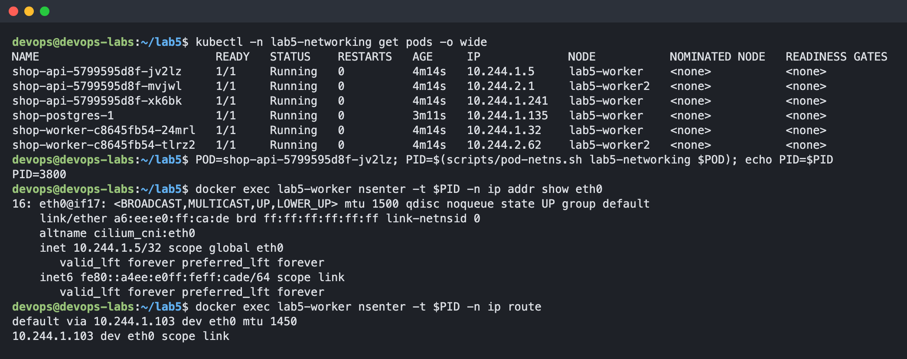

Внутри pod'а api есть интерфейс eth0@if17 с адресом 10.244.1.5/32, маршрут по умолчанию идёт через адрес cilium_host на ноде.

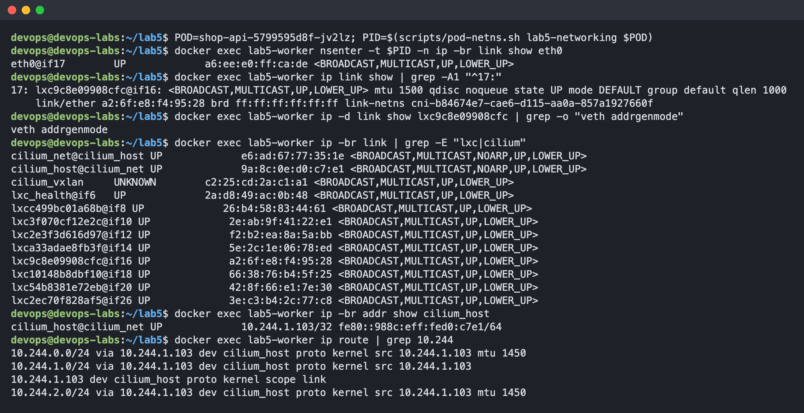

На ноде интерфейс с индексом 17 называется lxc9c8e09908cfc@if16, это вторая половина той же veth-пары. Подсети других нод маршрутизируются через cilium_host в VXLAN-туннель.

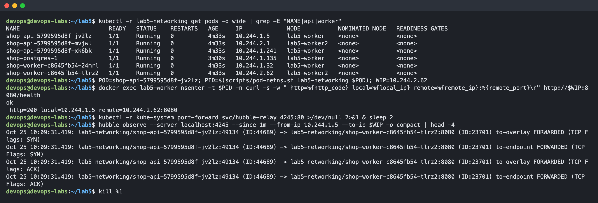

Pod api на одной ноде обращается к pod'у worker на другой ноде напрямую по IP и получает ответ

## Часть 2 — Непрерывность под хаосом pod'ов

api опубликован через Service типа NodePort на порту 30080.

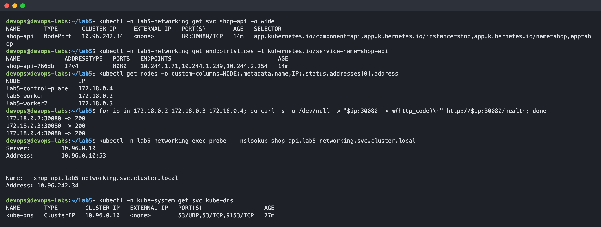

Чем отличаются типы Service:

- NodePort открывает один и тот же порт на каждой ноде, и запрос на любую ноду попадает на один из pod'ов, даже если на этой ноде pod'а нет. Какую ноду выбрать, решает сам клиент.
- LoadBalancer дополнительно создаёт внешний балансировщик с одним адресом, который распределяет трафик по нодам. Для этого нужен облачный провайдер или MetalLB.
- Headless Service не имеет виртуального IP: DNS возвращает адреса всех pod'ов, и клиент выбирает сам. Это нужно, например, для StatefulSet и реплик БД.

Скрипт pod-chaos.sh каждые 3 секунды удаляет случайный pod api или worker и раз в секунду записывает, какие адреса стоят за Service. Параллельно скрипт client-load.sh запускает pod-клиент, который непрерывно отправляет заказы на api по DNS-имени, каждый раз с новым соединением и без повторов. Прогон длился около 5 минут.

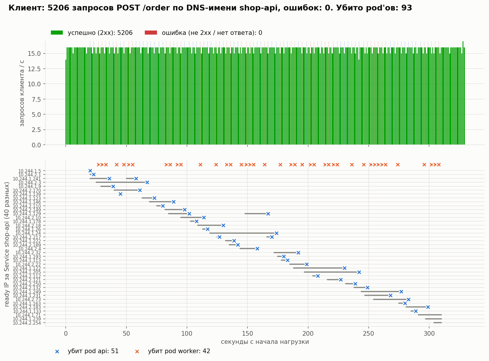

Клиент отправил 5206 запросов, ни один не завершился ошибкой. За это время было убито 93 pod'а (51 api и 42 worker), а за Service успело смениться 40 разных IP.

Почему это работает:

- Service даёт стабильное имя и виртуальный IP, которые не меняются при пересоздании pod'ов.
- DNS резолвит имя сервиса в этот виртуальный IP, а не в адреса pod'ов, поэтому клиенту не нужно знать о смене pod'ов.
- EndpointSlice хранит список готовых pod'ов. Новый pod попадает туда только после прохождения readinessProbe, удаляемый pod убирается сразу. Пока удаление расходится по нодам, api ещё несколько секунд отвечает на запросы благодаря preStop из lab3.
- Балансировщик переводит виртуальный IP в адрес живого pod'а из EndpointSlice.

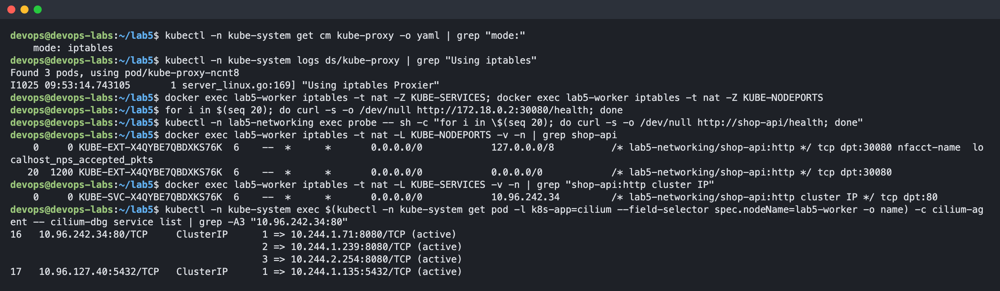

kube-proxy работает в режиме iptables. Разница между iptables и IPVS важна на больших кластерах. В iptables правила для сервисов проверяются последовательно и полностью пересобираются при любом изменении, поэтому при тысячах сервисов растут задержка и время обновления. IPVS использует хэш-таблицы, поиск занимает постоянное время, плюс есть выбор алгоритма балансировки. На кластере такого размера разницы нет.

## Часть 3 — Целевая матрица доступа

Client: pod-клиент внутри кластера; external: клиент снаружи через NodePort; stray: посторонний pod в namespace.

| Откуда \ куда | api       | worker    | postgres  | DNS       | интернет  |
| ------------- | --------- | --------- | --------- | --------- | --------- |
| external      | разрешено | —         | —         | —         | —         |
| client        | разрешено | запрещено | запрещено | разрешено | запрещено |
| api           | запрещено | запрещено | разрешено | разрешено | запрещено |
| worker        | запрещено | запрещено | разрешено | разрешено | запрещено |
| postgres      | запрещено | запрещено | разрешено | разрешено | запрещено |
| stray         | запрещено | запрещено | запрещено | разрешено | запрещено |
| Prometheus    | разрешено | разрешено | запрещено | —         | —         |

## Часть 4 — Zero trust в chart

Политики добавлены в chart как шаблоны, все метки и порты задаются в values.yaml:

1. default-deny запрещает весь входящий и исходящий трафик pod'ов namespace;
2. отдельные правила открывают маршруты из матрицы с указанием меток и портов, каждый маршрут описан с обеих сторон: исходящий трафик у источника и входящий у получателя;
3. отдельное правило разрешает DNS.

Для доступа postgres к kube-apiserver использована CiliumNetworkPolicy, так как стандартная NetworkPolicy в Cilium не позволяет корректно описать apiserver.

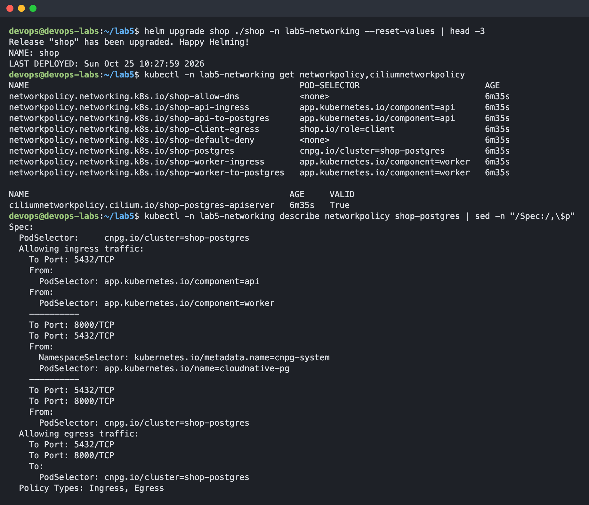

## Часть 5 — Проверка матрицы

Скрипт access-matrix.sh проверяет матрицу вживую: из каждого источника пробует подключиться к каждому назначению и сравнивает результат с ожидаемым

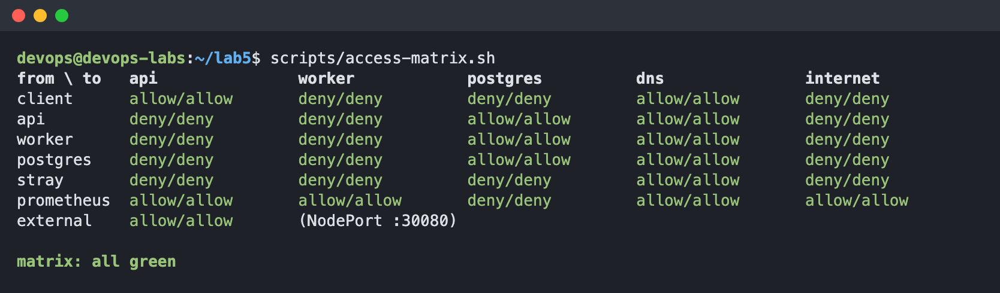

Все результаты совпали с ожидаемыми

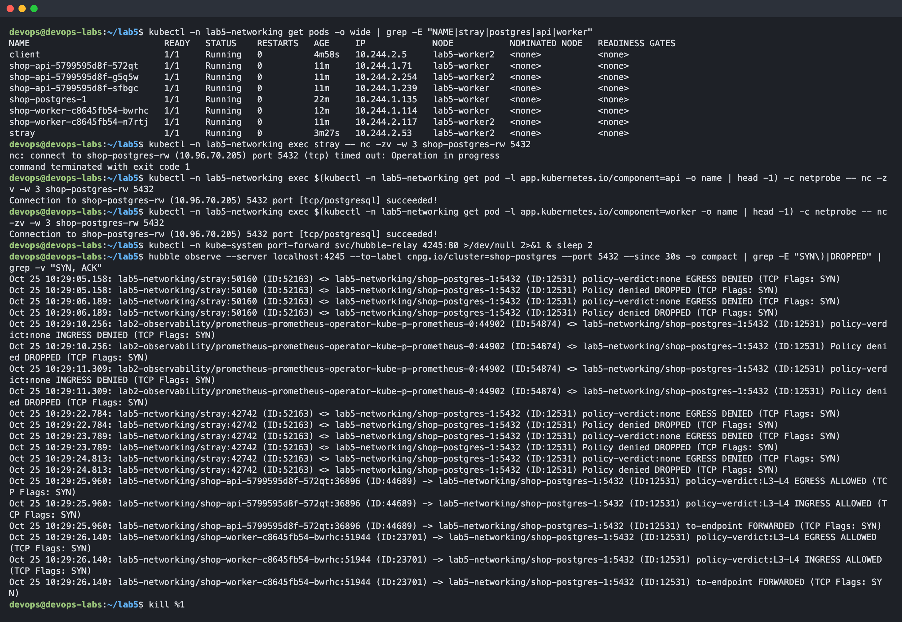

Посторонний pod не может подключиться к PostgreSQL, Hubble показывает, что его соединение отброшено политикой. api и worker подключаются.

## Часть 6 — Поиск скрытой поломки

Подготовлено четыре варианта поломки, которые применяются через values:

| Поломка                | Что меняется                                          | Ожидаемый симптом                      |
| ---------------------- | ----------------------------------------------------- | -------------------------------------- |
| неверный порт api      | в правиле указан порт Service вместо порта контейнера | клиенты не достучатся до api           |
| неверная метка worker  | опечатка в метке worker в правиле доступа к postgres  | заказы создаются, но не обрабатываются |
| нет DNS                | правило для DNS отключено                             | сервисы не находят postgres по имени   |
| неверный порт postgres | порт БД в правилах не совпадает с реальным            | api и worker не подключаются к БД      |

Скрипт hidden-fault.sh выбирает одну из них случайно и не сообщает, какую

**Симптом.** Pod'ы работают, клиенты получают успешные ответы, но новые заказы перестали обрабатываться. Значит, путь клиент → api → postgres работает, а сломан путь worker → postgres. Поломки с портами api и postgres сразу отпадают.

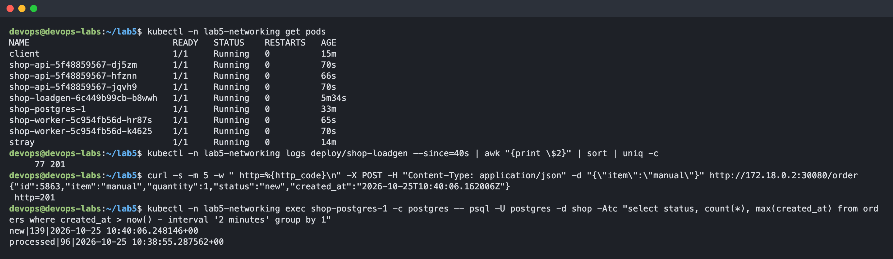

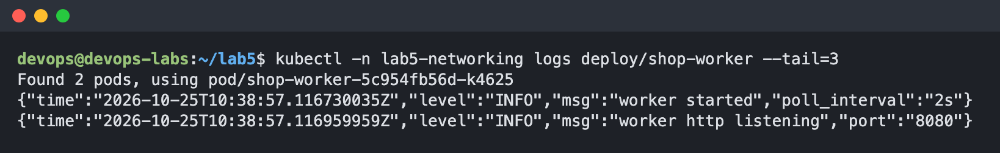

**Hubble.** Единственные отброшенные соединения от worker к postgres на порту 5432, отброшены на стороне worker, потому что к нему не подошло ни одно разрешающее правило. При этом api подключается к тому же postgres на тот же порт без проблем. Значит, DNS и порт в порядке, а правило для worker не выбирает pod'ы worker.

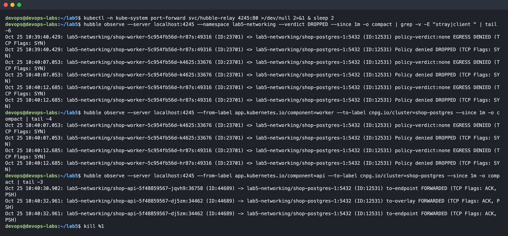

**Причина.** Правило доступа worker к postgres выбирает pod'ы с меткой workers, а у pod'ов метка worker. Это опечатка в values.

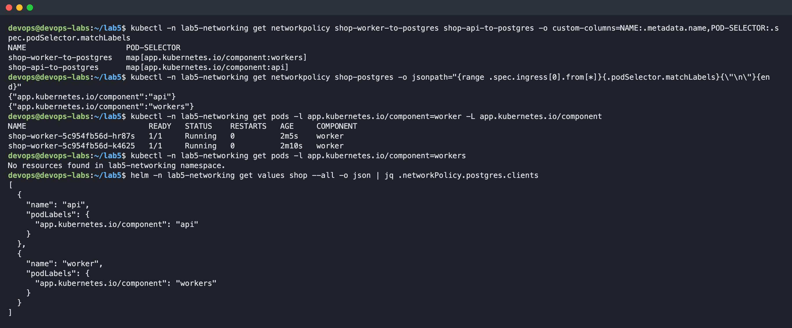

На карте Hubble UI соединение с postgres отмечено как отброшенное, а при фильтре по postgres видно, что потоки от api проходят, а от worker отбрасываются.

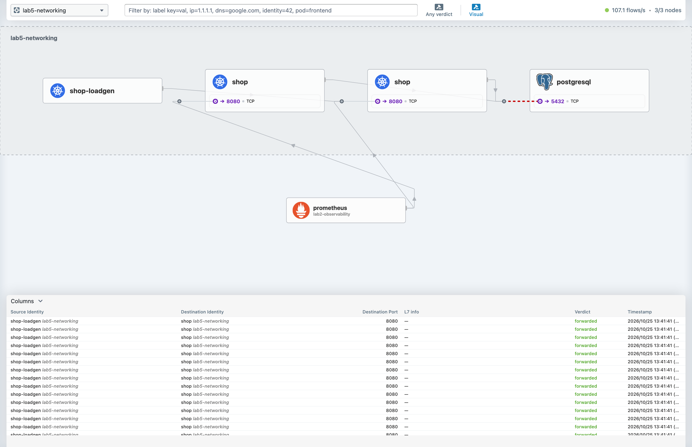

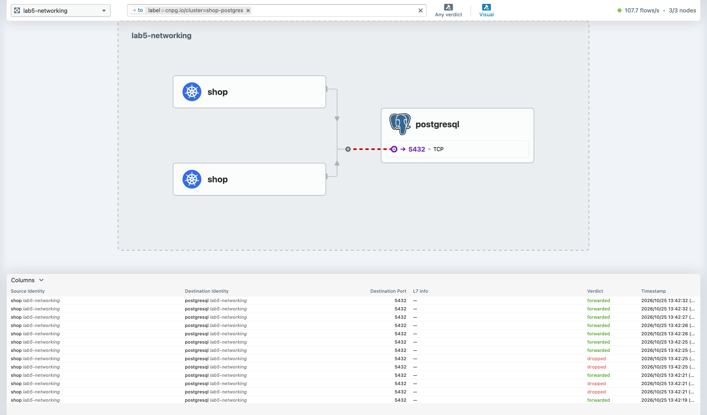

Мониторинг тоже поймал поломку: сработал алерт о блокировке разрешённого маршрута worker → postgres, на дашборде обработка заказов упала до нуля.

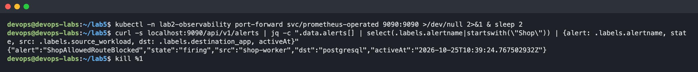

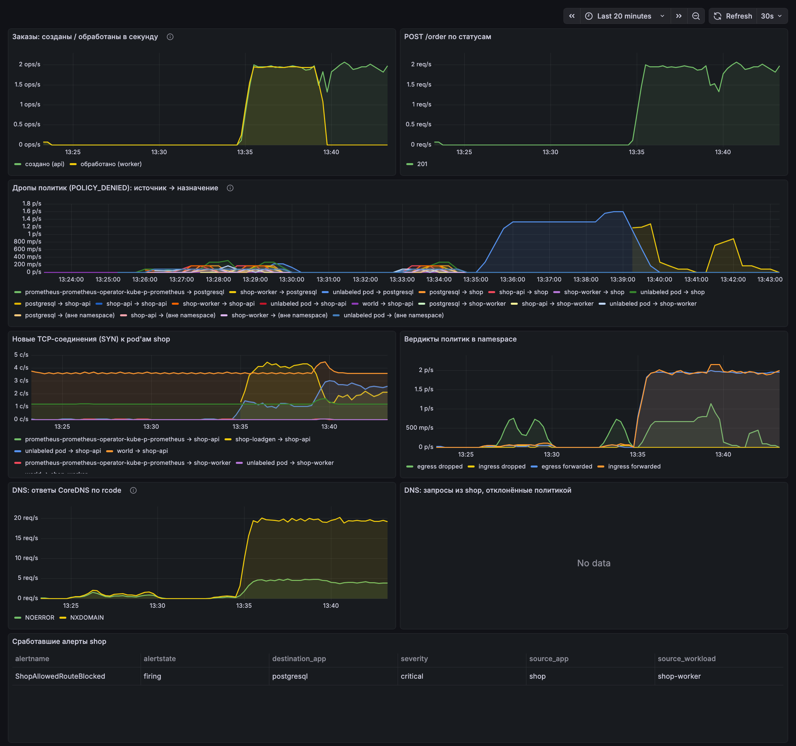

**Исправление.** Возвращён корректный values.yaml, worker сразу начал обрабатывать накопившиеся заказы.

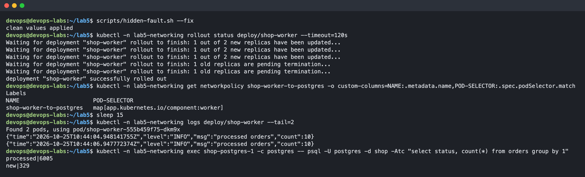

Матрица после исправления снова полностью совпадает с ожидаемой.

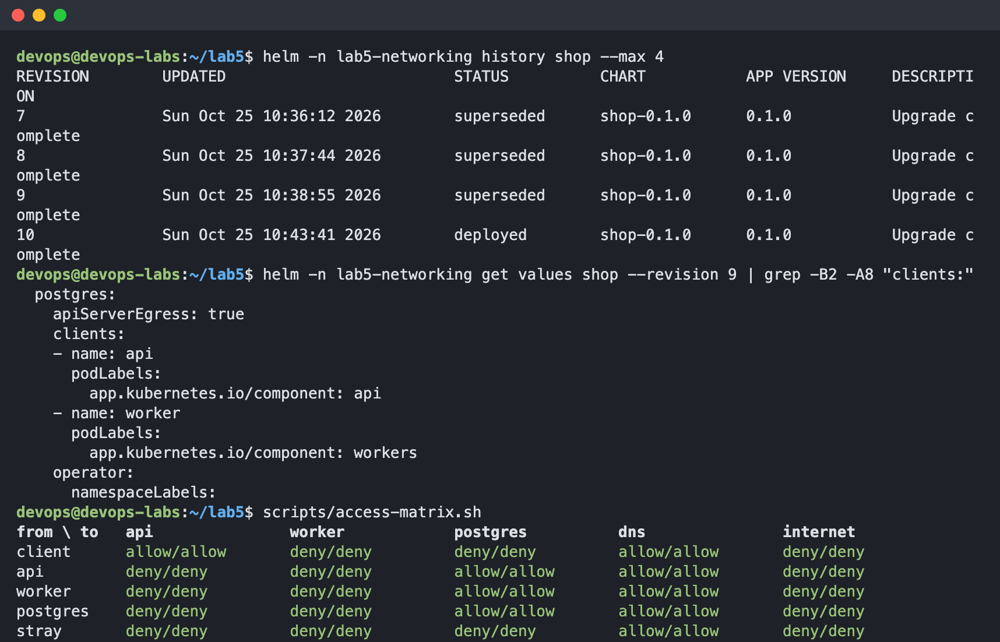

## Часть 7 — Мониторинг

Стек из lab2 поставлен в новый кластер.

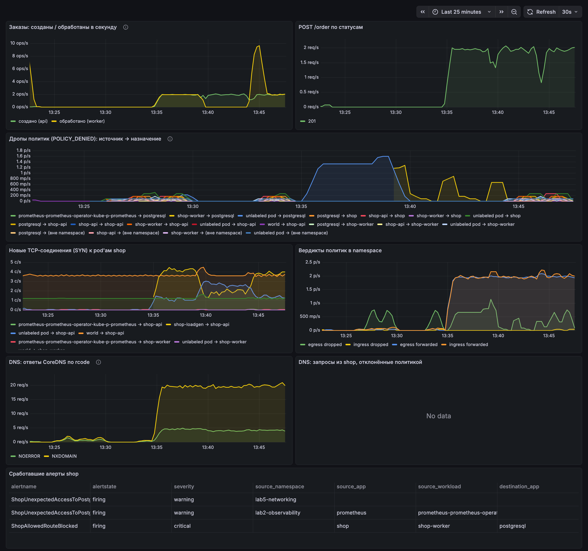

На дашборде видны начало нагрузки, остановка обработки заказов во время поломки из части 6, дропы worker → postgres и восстановление после исправления.

Алерты:

1. **ShopAllowedRouteBlocked** (critical): политика отбрасывает трафик на маршруте, который по матрице разрешён. Главный риск при zero trust: ошибка в собственном разрешающем правиле. Pod'ы при этом выглядят здоровыми, логи молчат, и без этого алерта поломку заметили бы только по жалобам клиентов.
2. **ShopDnsDegraded** (critical): DNS-запросы из namespace отбрасываются или CoreDNS отвечает ошибками. DNS чаще всего забывают разрешить при default-deny, а без него ломается всё, что обращается к сервисам по имени.
3. **ShopUnexpectedAccessToPostgres** (warning): кто-то, кроме api и worker, пытается подключиться к PostgreSQL. Политика уже защитила базу, но сами попытки говорят о постороннем pod'е или ошибке деплоя.

Срабатывание: посторонний pod несколько минут пытался подключиться к PostgreSQL, и через минуту сработал алерт ShopUnexpectedAccessToPostgres

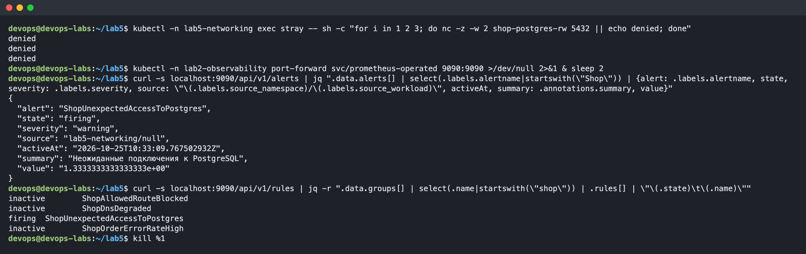

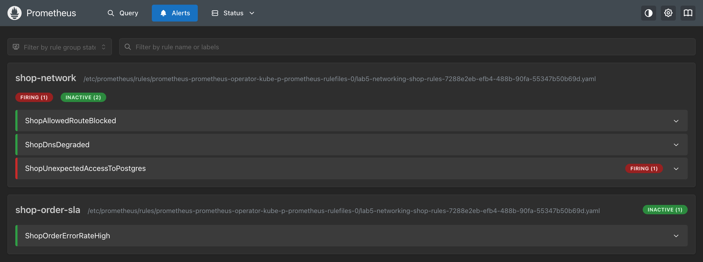
