## Подготовка

Лабораторная выполнена в том же кластере kind, что и lab5 (control-plane и две worker-ноды, CNI Cilium), в отдельном namespace lab6-mesh. Стек мониторинга из Lab 2 тот же. Дополнительно включён сбор метрик контейнеров (cAdvisor), чтобы мерить CPU и память, и разрешён сбор через PodMonitor.

Всё разворачивается chart'ом shop: версии api, Service, HTTPRoute для разделения трафика, аннотации mesh, gate, ServiceMonitor/PodMonitor, PrometheusRule и дашборд. Worker в этой лабораторной отключён, используются api и postgres.

## Часть 0 — Сервисы

api расширен:

- GET /version возвращает v1 или v2;
- FAIL=true заставляет POST /order отвечать 500 (для плохой v2);
- FLAKY=true заставляет часть POST /order случайно отвечать 500 (для v1, доля задаётся FLAKY_RATE, по умолчанию 30%);
- остальные эндпоинты прежние.

Обе ошибки возникают до записи в БД, поэтому повтор запроса не создаёт дубликат заказа. Обе версии собираются из одного образа, версия и поведение задаются через переменные окружения.

Gate-скрипт написан на Python и упакован в отдельный образ, логика описана в части 6.

## Часть 1 — Выбор mesh

Выбран Linkerd. Его прокси написан на Rust: лёгкий, почти без настройки, mTLS включается автоматически для всех pod'ов в mesh. Retries, circuit breaking и разделение трафика через HTTPRoute работают без дополнительных компонентов. Установка — несколько команд, а Linkerd нормально работает поверх Cilium.

Istio ambient обходится без sidecar, но для функций уровня запросов (retries, разделение трафика по весам) ему нужны отдельные waypoint-прокси. В итоге компонентов больше, и для одного сервиса это избыточно.

## Часть 2 — Базовая линия без mesh

api v1 (две реплики) и postgres развёрнуты chart'ом с выключенным mesh. Нагрузка — fortio внутри кластера: 100 запросов в секунду на POST /order в течение 2 минут. CPU и память контейнеров взяты из Prometheus как среднее за время нагрузки.

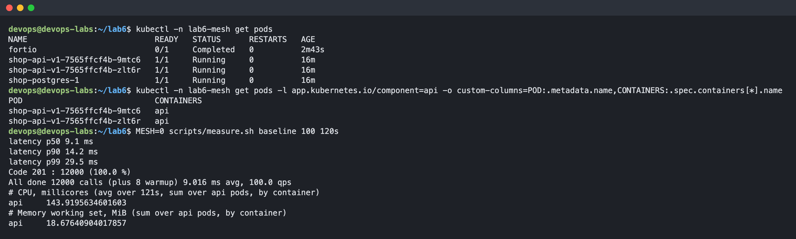

| Показатель | Без mesh |
|---|---|
| p50 | 9.1 мс |
| p90 | 14.2 мс |
| p99 | 29.5 мс |
| CPU двух pod'ов api | 144 millicores |
| Память двух pod'ов api | 18.7 MiB |

## Часть 3 — Mesh и mTLS

api включён в mesh аннотацией из values.yaml, Linkerd добавил в каждый pod прокси. Для проверки сделаны два клиента: один в mesh со своим ServiceAccount, другой вне mesh.

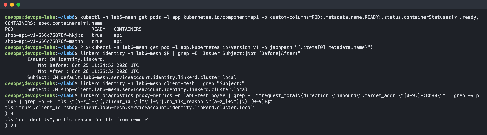

Каждый прокси получает сертификат, подписанный удостоверяющим центром Linkerd. Имя в сертификате формируется из ServiceAccount (default у api, shop-client у клиента), а не из IP. Прокси api видит запросы клиента из mesh с пометкой о TLS и его identity, а запросы клиента вне mesh — как незашифрованные, без identity.

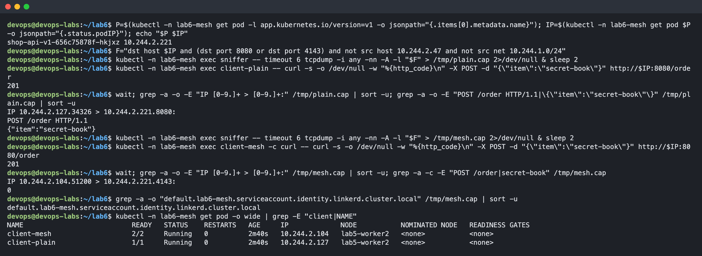

Трафик снят tcpdump на ноде. Запрос от клиента вне mesh виден целиком: метод, путь и тело заказа. Тот же запрос от клиента в mesh идёт на входной порт прокси 4143 в виде TLS: ни пути, ни тела в захвате нет, в открытом виде видно только имя сервера (identity api) из TLS-рукопожатия.

Связь api → postgres осталась без шифрования, потому что postgres не включён в mesh.

## Часть 4 — Надёжность без изменения кода

На v1 включён FLAKY=true, постоянный клиент в mesh отправляет 20 заказов в секунду. Первые 3 минуты mesh работал без retries, затем retries включены аннотацией на Service: повторять ответы 5xx, не больше 3 повторов.

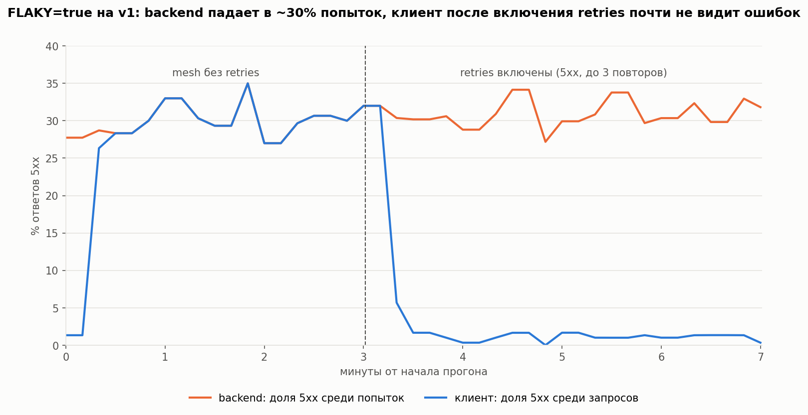

Backend всё время отвечает ошибкой примерно на 30% попыток. Без retries клиент видит те же 30%, с retries — около 1%. Это совпадает с расчётом: запрос теряется, только если провалились все 4 попытки, 0.3 в четвёртой степени ≈ 0.8%.

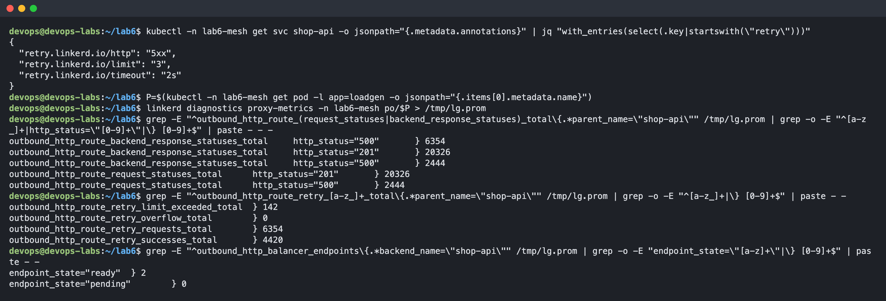

Механизм определён по метрикам клиентского прокси Linkerd:

- число попыток к backend больше числа запросов клиента, и есть счётчики повторов: из 6354 повторов 4420 закончились успехом, 142 упёрлись в лимит. Значит, работали retries;
- circuit breaking не участвовал: он не был включён, а балансировщик не исключил ни одного backend'а (все 2 в состоянии ready, 0 исключённых). Да и смысла в нём не было: при случайных ошибках длинных серий подряд почти не бывает, а сбоят оба pod'а одинаково.

## Часть 5 — v1 и v2, разделение трафика

v1 и v2 развёрнуты одновременно. Разделение трафика — объект HTTPRoute из chart'а: родитель — общий Service shop-api, backend'ы — Service каждой версии с весами 90 и 10. HTTPRoute принят контроллером Linkerd.

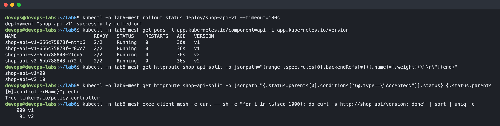

Из 1000 запросов GET /version 909 обработала v1 и 91 — v2, что соответствует 90/10.

## Часть 6 — Автопилот

Gate запускается как Deployment из chart'а. Права у него только на чтение и изменение одного HTTPRoute.

Каждые 15 секунд gate берёт из Prometheus метрики v2 со стороны mesh за последние 30 секунд: поток запросов, долю ошибок и p95 латентности. Учитываются только запросы клиентов по mTLS, пробы kubelet и сбор метрик не считаются.

Правило:

- если на v2 меньше 0.5 запроса в секунду, данных мало, вес не меняется;
- если доля ошибок v2 больше 5% или p95 больше 300 мс, вес v2 сразу сбрасывается в 0 (откат) и gate останавливается;
- иначе вес v2 увеличивается на 10; когда он доходит до 100, релиз считается завершённым.

Все пороги и шаг задаются в values.yaml.

## Часть 7 — Два сценария

Каждый сценарий начинается с состояния «работает только v1». Затем v2 выкатывается со split 90/10 и запускается gate, дальше всё решает он.

**Плохой релиз** (v2 с FAIL=true). Как только на v2 пошло достаточно трафика, gate увидел 100% ошибок и на третьей проверке, через 45 секунд, сбросил вес v2 в 0. Клиент ошибок не заметил: упавшие на v2 запросы повторялись и уходили на v1.

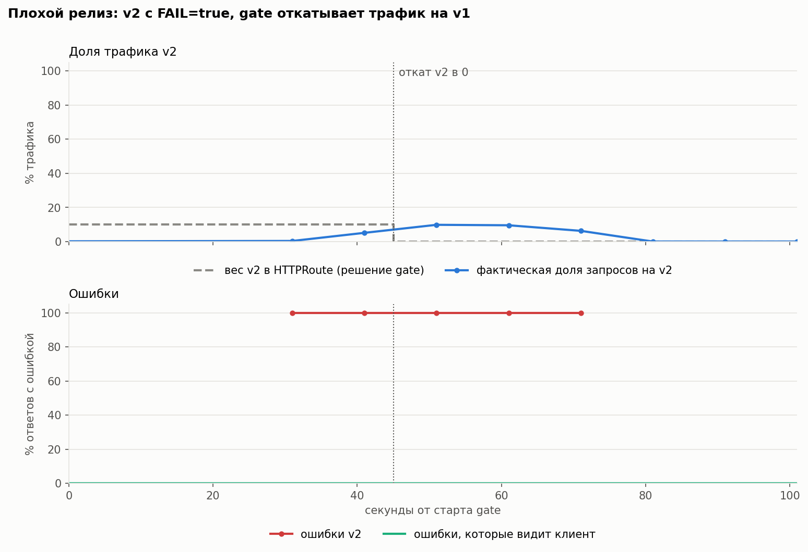

**Хороший релиз** (v2 с FAIL=false). Ошибок нет, латентность около 10 мс, и gate каждые 15 секунд поднимал вес v2 на 10, пока не довёл до 100%. Весь переход занял около 2.5 минут, клиент ошибок не видел.

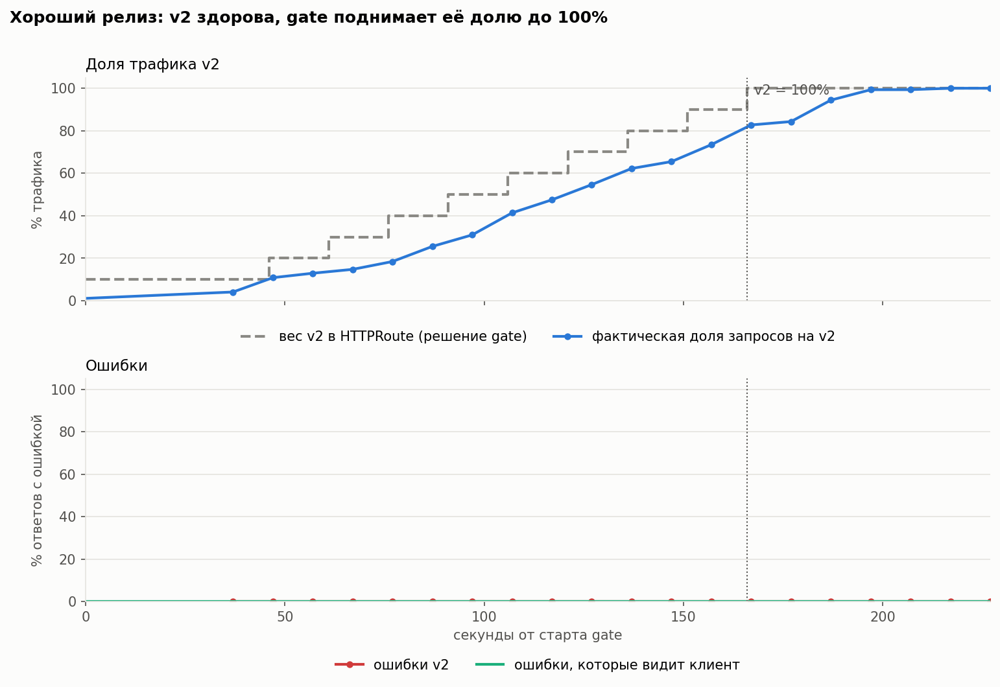

Решения gate по обоим сценариям:

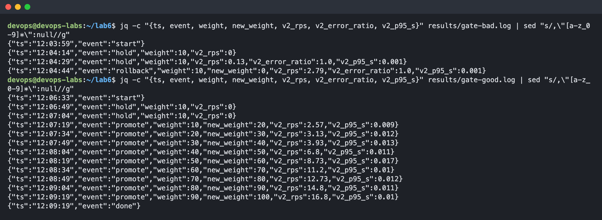

## Часть 8 — Цена mesh и вывод

Замер из части 2 повторён в той же конфигурации (v1, две реплики, 100 запросов в секунду, 2 минуты), но api и клиент в mesh.

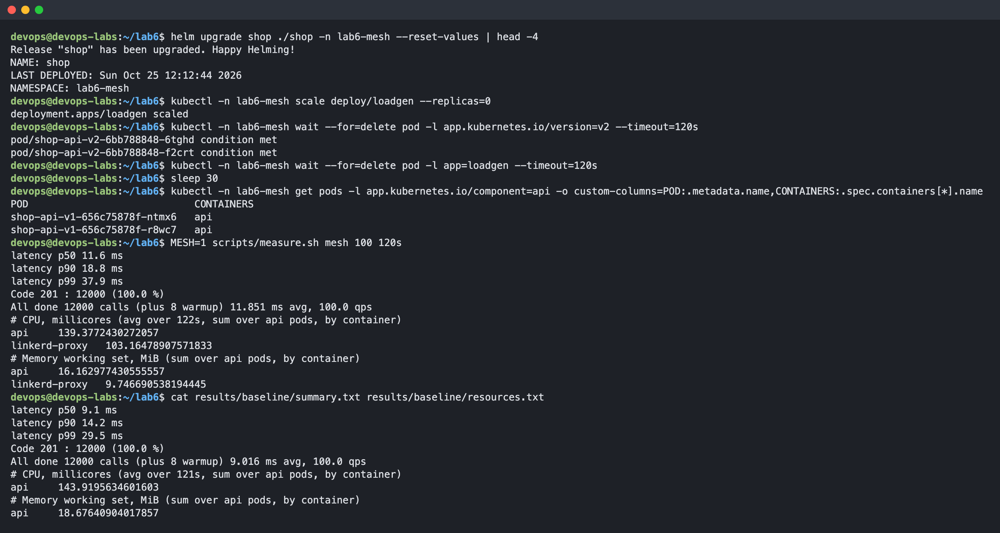

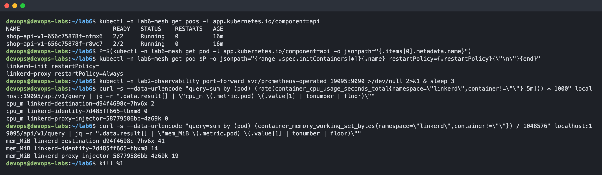

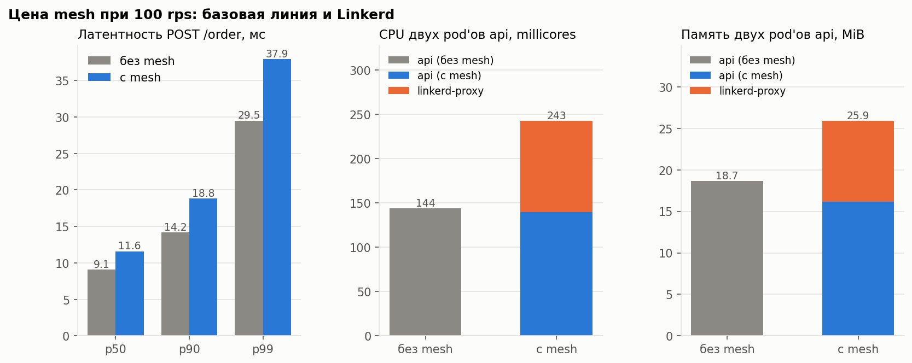

| Показатель | Без mesh | С mesh | Разница |
|---|---|---|---|
| p50 | 9.1 мс | 11.6 мс | +2.5 мс (+27%) |
| p90 | 14.2 мс | 18.8 мс | +4.6 мс (+32%) |
| p99 | 29.5 мс | 37.9 мс | +8.4 мс (+28%) |
| CPU двух pod'ов api | 144 m | 243 m (api 139 + прокси 103) | +99 m (+69%) |
| Память двух pod'ов api | 18.7 MiB | 25.9 MiB (api 16.2 + прокси 9.7) | +7.2 MiB (+39%) |

Сверху к этому добавляются прокси у каждого клиента и control plane Linkerd: около 74 MiB памяти и почти ноль CPU.

**Вывод.** В абсолютных числах mesh дешёвый: несколько миллисекунд при пороге в 300 мс и десятки мегабайт памяти. Но относительно такого маленького сервиса это заметно: прокси съедает почти столько же CPU, сколько само приложение. При этом пользы немного: в системе один HTTP-сервис и одна связь клиент → api, а база вне mesh.

Для shop такого размера mesh скорее не оправдан: retries можно сделать в клиенте, а canary — средствами Ingress или Argo Rollouts. Mesh становится оправдан, когда сервисов много и нужны единые правила mTLS, повторов и наблюдаемости для всех связей сразу или когда mTLS обязателен по требованиям безопасности.

## Часть 9 — Мониторинг

В chart добавлены:

- ServiceMonitor для метрик приложения api;
- PodMonitor для прокси Linkerd;
- PrometheusRule с тремя алертами;
- дашборд Grafana.

Панели дашборда: доля трафика по версиям, доля ошибок и p95 по версиям, ошибки backend против ошибок у клиента, запросы клиента против попыток к backend и CPU приложения и прокси.

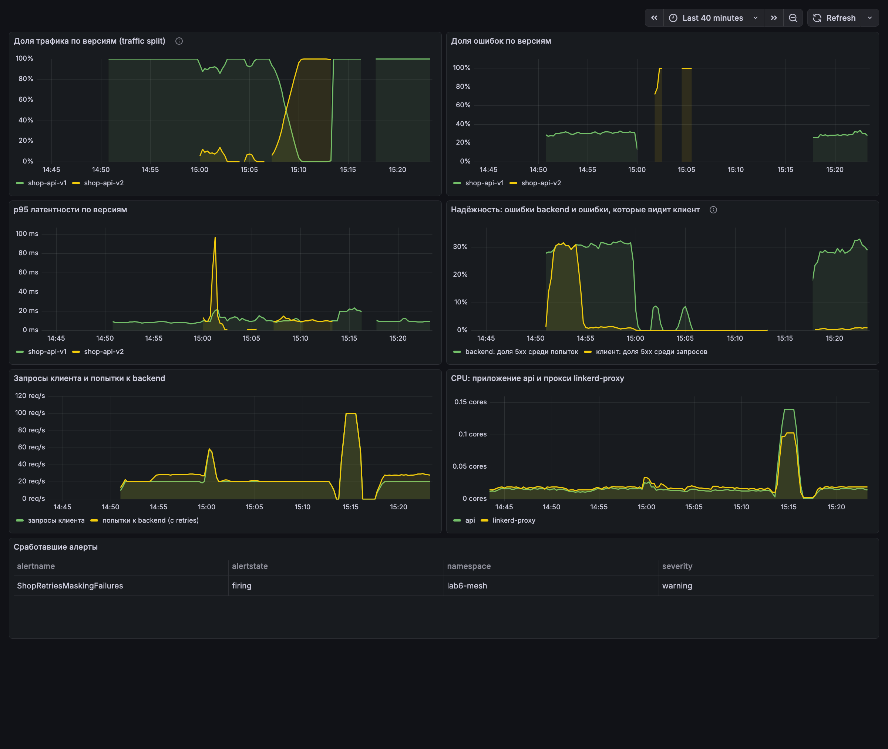

Алерты:

1. **ShopCanaryErrorRateHigh** (critical) — доля ошибок v2 выше 5%. Новая версия в canary сломана; gate откатит её сам, но человек должен узнать о плохом релизе и проверить, что откат произошёл.
2. **ShopClientErrorRateHigh** (critical) — клиенты получают больше 1% ошибок даже после retries. Это то, что видит пользователь, то есть прямое нарушение SLO.
3. **ShopRetriesMaskingFailures** (warning) — больше 10% попыток к backend заканчиваются ошибкой. Retries скрывают проблему от клиента, но backend при этом сломан, а повторы дают ему дополнительную нагрузку. Без этого алерта деградацию заметили бы только тогда, когда retries перестанут справляться.

Срабатывание: во время плохого релиза сработал ShopCanaryErrorRateHigh, а при повторном включении FLAKY на v1 — ShopRetriesMaskingFailures. ShopClientErrorRateHigh при этом молчал: клиент ошибок почти не видел.

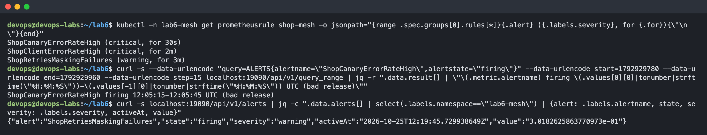
