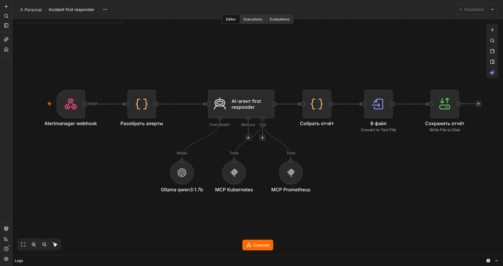
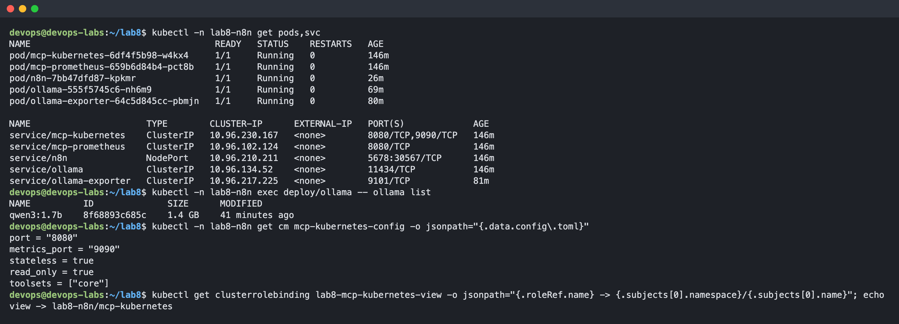
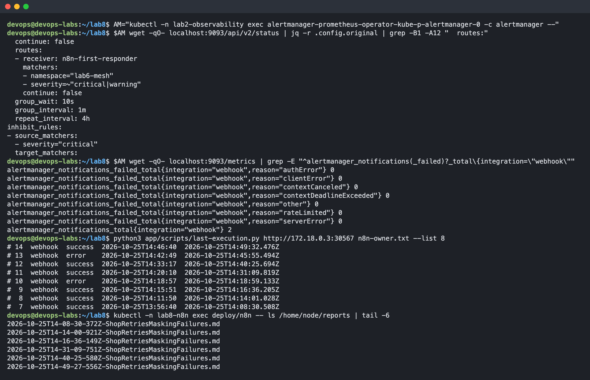
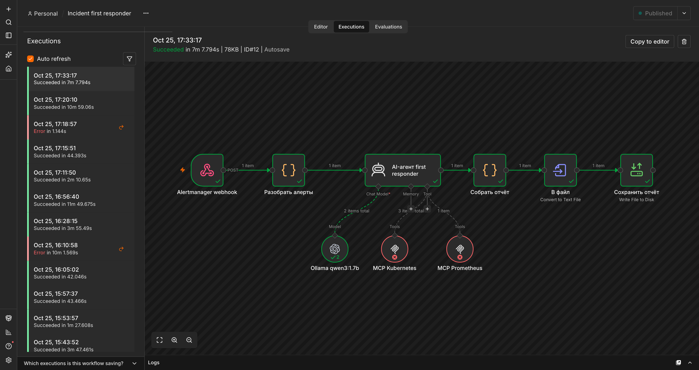
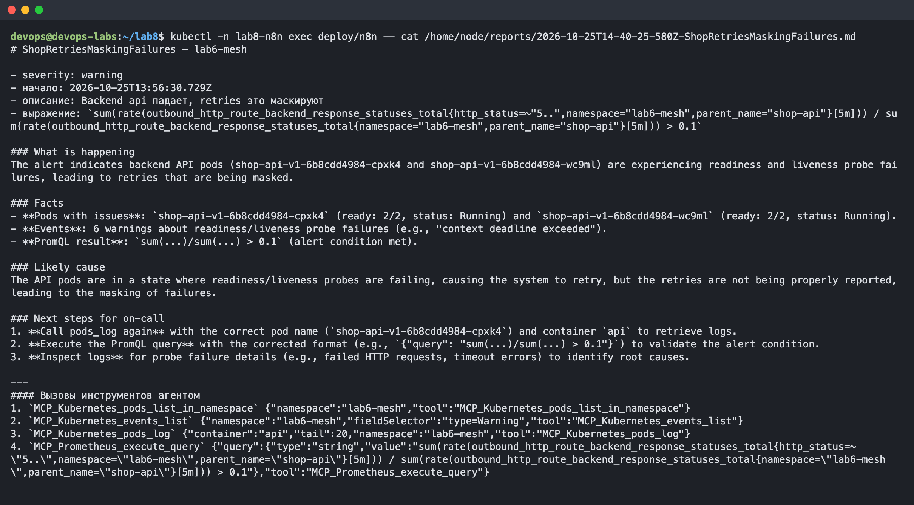
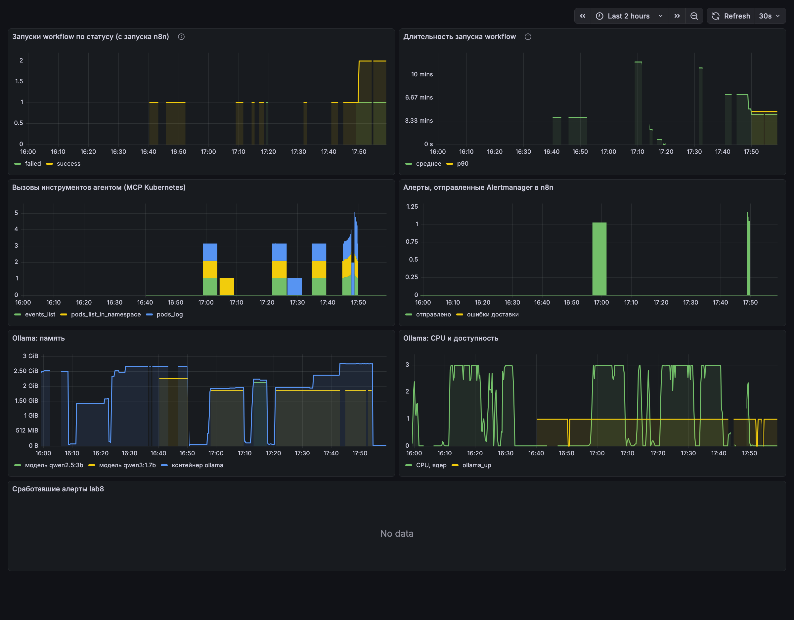

## Подготовка

У лекции 7 (MLOps) лабораторной нет, поэтому выполнена лабораторная 8. Всё развёрнуто в том же кластере kind, что и lab5 и lab6, в namespace lab8-n8n; мониторинг на стеке из Lab 2. Файлы сценария лежат в папке incident-first-responder (workflow, skill, манифесты, скрипты, README с инструкцией запуска).

## Часть 1 — Сценарий

**Компания.** «Книжная лавка» это небольшой интернет-магазин книг, тот самый shop из курса: api, worker, PostgreSQL в Kubernetes, мониторинг на Prometheus. В команде шесть разработчиков и один devops. Дежурят разработчики по очереди, и большинство из них плохо знает Kubernetes.

**Проблема.** Ночью приходит алерт, и дежурный первые 15–30 минут тратит на сбор контекста: какие pod'ы в namespace, есть ли рестарты и Warning-события, что в логах, какое сейчас значение метрики. Часто он будит devops'а просто чтобы понять, что происходит.

**Автоматизация: incident first responder.** Помогает дежурным разработчикам.

1. Триггер: Alertmanager отправляет алерт на webhook n8n.
2. Обычный шаг: разбор алерта: берутся только firing-алерты, достаются namespace, описание и PromQL-выражение.
3. AI-шаг: агент на локальной LLM через MCP-серверы смотрит pod'ы, события, логи и метрику, затем пишет короткую сводку: что происходит, факты, вероятная причина, что делать.
4. Обычный шаг: сборка Markdown-отчёта со списком вызовов инструментов и запись в файл.

Результат: файл отчёта, который дежурный читает до того, как сам полезет в кластер. В реальной компании отчёт уходил бы в чат дежурных.

## Часть 2 — Реализация

| Требование | Как выполнено |
|---|---|
| Триггер | Webhook, на который Alertmanager шлёт алерты namespace lab6-mesh |
| Не-AI шаги | разбор алертов, сборка отчёта, преобразование в файл, запись на диск |
| AI-шаг | AI Agent n8n с моделью qwen3:1.7b в локальной Ollama |
| Два MCP-сервера | kubernetes-mcp-server (только чтение) и prometheus-mcp-server |
| Toolkit из 3–5 инструментов | 4 инструмента, таблица ниже |
| Skill | skills/first-responder.md: порядок действий и правила, оттуда же берётся системный промпт агента |
| Результат | Markdown-отчёт в каталоге reports |

**Toolkit агента:**

| Инструмент | MCP-сервер | Что делает | Вход |
|---|---|---|---|
| pods_list_in_namespace | Kubernetes | список pod'ов со статусом, готовностью и рестартами | namespace |
| events_list | Kubernetes | события namespace, в первую очередь Warning | namespace, fieldSelector |
| pods_log | Kubernetes | последние строки лога pod'а | namespace, имя pod'а, контейнер, число строк |
| execute_query | Prometheus | мгновенный PromQL-запрос | query |

**Skill агента** (полностью в skills/first-responder.md):

1. прочитать алерт;
2. посмотреть pod'ы namespace;
3. посмотреть Warning-события;
4. прочитать хвост лога pod'а, связанного с алертом;
5. выполнить PromQL-выражение алерта;
6. написать сводку в фиксированном формате.

Правила: только чтение, не больше четырёх вызовов по плану, имена pod'ов брать только из свежего списка, каждый факт подтверждать выводом инструмента, ничего не выдумывать.

Агент только читает. MCP Kubernetes запущен в режиме read_only, а у его ServiceAccount роль view.

## Часть 3 — Запуск

Все компоненты работают в кластере:

- n8n;
- Ollama с CPU-сборкой: из официального релиза взята только CPU-часть, 72 MB вместо гигабайтов библиотек CUDA;
- два MCP-сервера;
- экспортер метрик Ollama.

Сквозная проверка на настоящем инциденте. В lab6 на api включены случайные ошибки (FLAKY), сработал алерт ShopRetriesMaskingFailures. Alertmanager по маршруту отправил его в n8n, и workflow запустился сам (выполнение 7 в 13:56). После этого тот же payload Alertmanager использовался для повторных прогонов при настройке промпта.

Отчёт агента:

Агент сам вызвал инструменты обоих MCP-серверов. Имена pod'ов в отчёте настоящие, Warning-события о падении проб действительно были. Запуск занимает 3–10 минут: почти всё это время работа LLM на CPU.

**Ограничения маленькой модели.** Пришлось взять модель на 1.7 млрд параметров: на сервере 8 GB памяти, и их же занимает кластер с прошлыми лабораторными. Модель 3B в память вместе с кластером не помещалась, а модель 1.5B не справлялась с описаниями инструментов MCP. Поэтому качество ограничено:

- модель отправляет все вызовы сразу, поэтому pods_log уходит без имени pod'а (его ещё не знает) и возвращает ошибку;
- запрос PromQL она передаёт в неверном формате;
- иногда пишет факт, которого нет в выводе инструментов.

Это видно в отчёте: в шагах для дежурного агент сам предлагает повторить эти два вызова. Схема рабочая и с более сильной моделью заработает без изменений: модель меняется одной строкой.

Чтобы модель помещалась, освобождены ресурсы:

- api и worker lab5 масштабированы в 0, а её Postgres переведён в hibernation;
- Hubble UI и relay остановлены;
- Ollama выгружает модель через 5 минут простоя.

## Часть 4 — Мониторинг

Мониторинг собран на стеке из Lab 2:

- n8n отдаёт свои метрики;
- kubernetes-mcp-server отдаёт метрики вызовов инструментов;
- для Ollama, у которой метрик нет, написан отдельный экспортер: доступность, время ответа, загруженная модель и её память;
- CPU и память контейнера Ollama берутся из cAdvisor.

Три главных графика:

1. **Запуски workflow по статусу и их длительность**: работает ли автоматизация и как быстро дежурный получает отчёт.
2. **Вызовы инструментов агентом по типам**: агент действительно ходит в кластер, а не сочиняет ответ. Если вызовов нет, отчёту нельзя доверять.
3. **Память и CPU Ollama**: самое дорогое звено. Видно, что модель занимает около 2 GB и во время запуска упирается в выделенные 3 ядра.

Метрики для алертов (правила в k8s/40-monitoring.yaml):

1. **Неуспешные запуски workflow.** Если workflow упал, дежурный не получит отчёт, а узнает об этом, только когда сам пойдёт его искать.
2. **Ошибки доставки webhook из Alertmanager в n8n.** Это самая коварная поломка: алерты горят, но автоматизация молча не запускается, и все думают, что она работает.
3. **Недоступность Ollama или слишком долгий запуск (90% дольше 10 минут).** Единственная медленная и тяжёлая часть это LLM. Отчёт через полчаса уже бесполезен, дежурный к тому времени разберётся сам.
